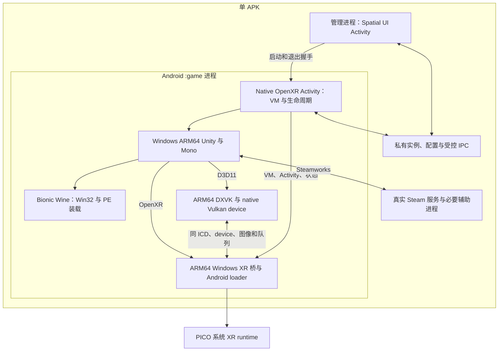

# 产品架构与开发方式

更新：2026-10-11。本文定义后续开发共同遵守的架构；组件与更新契约见 [组件清单](COMPONENTS.md)，执行顺序见 [ROADMAP](ROADMAP.md)，实际完成情况只维护在 [STATUS](../STATUS.md)。这是实现目标，不是已运行通过的说明。

## 目标与明确不做的事

- 无 root、无 PRoot、单 APK，在 Pico Space Pro 本地运行用户正版 PC Beat Saber；先完成原版 1.44.1 的双眼菜单和一首可玩的歌曲，再接入 mod。
- Spatial UI Activity 负责游戏准备、账号和设置，最终成为 mod／谱面管理器；Native OpenXR Activity 负责沉浸式游戏。游戏图像不经过 Spatial 的二次渲染。
- 游戏 CPU 热路径不经过 x86→ARM 转译：同版本 Windows ARM64 Unity Player + Unity ARM64 Mono，将原 Managed IL **JIT** 编译成 ARM64 机器码。游戏仍使用 Windows ABI，不变成 Android Unity 项目。
- 不开发 LIV、混合现实录制、桌面捕获或其专项验证。不追求其完整 ARM64 库；仅沿用已有明确返回“无捕获”的游戏调用兼容边界，避免闲置 SDK 每帧抛异常。已有上游录制资料是历史事实，不是产品任务。
- 首轮不安装 BSIPA、不加载 mod、不做假的 mod 页面；保留后续实例目录和启动配置边界。BSIPA／mod／自定义谱面是 [后续开发](mod-chart-manager.md)，不是原版可玩的前置条件。

## 运行层次

| 层 | 实现选择与职责 |
|---|---|
| Android 管理宿主 | 沿用 `prototypes/spatial-openxr/` 的 Spatial 入口与 Activity 交接，演进为产品；不用另造一套 APK。管理进程拥有 UI、配置和资源管理。 |
| Windows 游戏 | Unity 6000.0.40f1 的 ARM64 Player／Mono，匹配 Unity OpenXR 1.14.3；保留正版 Managed IL 和 Windows 资源平台。 |
| Win32 兼容 | 以 GameNative 的 **Bionic ARM64 Wine／Proton 移植**为基线，编译 Android ELF Unix 半边；在产品中实现装载、文件、线程、异常、同步和窗口等所需语义。 |
| 图形 | 真正 ARM64 PE 的 DXVK `d3d11.dll`／`dxgi.dll`，D3D11→Vulkan；Wine Vulkan 映射连接 native 对象。DXVK 是 Proton 组件，但默认发布 DLL 不一定适用于纯 ARM64。 |
| XR | ARM64 UnityOpenXR／Windows loader／Wine XR 桥→Android loader→PICO 系统 runtime，转换 D3D11 图形绑定与帧、空间、输入。不部署桌面 SteamVR。 |
| Steam | 管理 UI 的真实登录／库／下载，与游戏运行时的真实 Steamworks 客户端服务分开实现；账号和所有权保持真实。 |
| 音频 | Windows 音频→Wine Android 后端→Android 输出；先复用可获取的 AAudio／PulseAudio 集成，后续只按实际音画问题优化。 |

Android ARM64 ELF、Windows ARM64 PE、ARM64EC 分别记录。游戏必经 DLL 必须提供兼容的 ARM64 入口，不能用 x64 或仅 ARM64EC DLL 凑齐；Wine ARM64X 系统模块按其实际 ARM64 入口处理。Box64／FEX 不进入游戏 CPU 主链，若真实 Steam 辅助程序必须使用它们，只允许在独立服务路径记录并隔离。

当前不预装 glibc 用户态环境、VKD3D 或完整通用游戏容器。Bionic 是直接对接 Android libc／loader／音频／GPU 的首选基线，不是自动移植 Linux 二进制的工具；实际问题在开发中修正。文中的 Wine、驱动、音频和服务候选不是穷尽列表；发现更合适的方案时按下文调研／Ask 流程选择，不把未经证明的基线当成固定技术禁区。

## 进程、Activity 与对象所有权

首选实现布局如下；Wine 同进程入口需要在 D1 中真正实现，不能当作 GameNative 已有能力。

- 管理进程才初始化 Spatial SDK；`:game` 不因公共 Application／provider 入口再次初始化管理渲染。Activity 不拥有另一个与游戏竞争的帧循环。
- 游戏与 Android XR 桥优先同进程、同 Vulkan ICD／device。通过 Proton DXVK interop 取得设备／队列并包装 runtime swapchain 图像；Wine client 句柄先按锁定源码转换为 native 句柄。
- `XrInstance`／`XrSession` 由 Android XR 桥持有并受 Native Activity 生命周期约束；图像由系统 runtime 所有，DXVK 包装层不销毁或重新绑定其内存。队列同步、layout 和 acquire／wait／release 明确归属。
- 管理与游戏只交换配置、启动结果和退出状态，不逐帧交换图像或 pose。会话带唯一身份，旧 Activity／worker 的回调不得修改新会话。
- 管理场景关闭并确认释放后进入游戏；正常退出先暂停游戏／音乐、结束 XR 并释放资源，再恢复管理。Home、失焦和重建沿实际 Android／XR 状态处理，不以强杀作为正常退出。

**同进程方案遇到 Wine／ART 信号、TLS、JIT 或退出冲突时**，在正在开发的功能内调查修复和其他布局，不只从本文候选中二选一；改变进程／图形交接架构前先用 Ask 说明实质取舍。当前备选为 Wine 子进程＋Android XR 进程，图像只通过双端支持的 AHardwareBuffer／dma-buf 与 fence／外部同步导入，禁止跨进程直接传 `VkImage` 指针或使用实时 CPU readback。明确对应帧序号、预测时间、图像租约和异常关闭协议；选定后记录采用布局，删除被替代实现，不保留双重默认后端。

这是实现分支选择，不再建立一轮独立可行性项目；先继续可实现的产品功能，只有关键能力确实没有可用实现时才报告不可替代缺项，供用户决定是否停止项目。

## GPU 与 XR 时间线

- 默认系统 Vulkan 驱动；只在实际 DXVK／XR 功能缺失、渲染错误或测得性能问题时调研可用替代驱动并通过 Ask 选择。Turnip 是当前候选之一，是 Adreno 用户态 Vulkan 驱动，不是 Linux→Android 必需层，也不替换内核。
- 同 GPU 不等于同 ICD／device。系统驱动、Turnip、Wine wrapper 的句柄不能混用；跨 device 必须重新导入资源，并验证格式与同步。
- 先完成正确图像与同步；优先直接包装 swapchain，必要时同 device GPU copy。减少复制、镜像、shader 编译尖峰等优化在实际游戏路径内做，不用每帧 `vkDeviceWaitIdle` 掩盖设计问题。
- 游戏请求的 `xrWaitFrame → xrBeginFrame → xrEndFrame` 转接到唯一真实 runtime 时间线；同帧预测显示时间用于 views、头／双手和投影。不给同步失败生成假成功时间，不把无效 pose 标有效。
- 坐标、米制比例、左右眼、FOV、颜色空间以及 QPC／XrTime 转换在游戏里实现和检查；不重复翻转 Unity 插件已经转换的坐标。

## 数据与后续扩展契约

D1 落地版本化实例模型；以下是待实现的项目接口，不是现有 SDK API。其定义在此统一维护，各阶段只补充自己的数据，不另造启动模型：

- `GameInstance`：`schemaVersion/instanceId/sourceId/manifestRef/gameVersion/workRoot/prefixRoot/userDataRoot/runtimeSetId/resolutionSnapshotRef/backupManifestRef/modsEnabled/modProfileId/modRoot/chartRoot/configRoot`。`runtimeSetId` 绑定兼容的引擎、宿主／PE ABI、源码与补丁锁；`resolutionSnapshotRef` 固定已准备组件，定义统一见 [组件契约](COMPONENTS.md)。`manifestRef` 对应输入、安装变更与恢复记录。
- `LaunchRequest(instanceId,runtimeSetId,resolutionSnapshotRef,steamSessionRef,runId)`：不可变启动请求；服务引用不含凭据，路径从已提交实例读取，不接任意 shell 命令；本次运行使用固定快照，不在游戏中重新追随云端清单。
- `RunState`：`runId/instanceId/phase/stage/error/logRefs`；phase 为 `preparing/starting/engine-running/xr-ready/playing/stopping/exited/failed`。进程存在不等于引擎运行、XR ready 不等于可玩，状态来自实际执行和游戏行为，不合成成功。
- D2 的 `prepareRuntime(instanceId,runId)` 返回不含凭据的服务引用／`runtimeReady` 或实际错误；ready 只表示可接受真实调用，最终授权由游戏 Steamworks 请求决定。
- 首轮 `modsEnabled=false`、`modProfileId=null`，加载器保持关闭；后续 mod／谱面目录属于工作实例，不混入唯一原始输入。数据／配置更新低频经过私有文件和受控 IPC，逐帧图像／pose 不进入管理进程。

正版本地导入与 Steam 下载使用同一实例准备流程。下载／更新先写独立临时或版本目录，校验后提交；当前游戏会话使用已提交且不在运行中替换的资源版本，游戏可写状态与更新事务分开。所有可能写入游戏的操作先按 [备份流程](../build/README.md#正版游戏输入与备份)保护原件，不能以硬链接作为隔离。

APK／Git 不包含游戏、凭据、票据、Unity 受限二进制或未经许可的第三方组件。可再分发运行时按许可打包；受限文件在用户侧合法准备。GameNative 的启动兼容、Steam bootstrap 和部分 KGSL 组件含闭源专有部分；公开源码可以参考，缺失部分在实际功能中自行实现或获取合法授权，不能宣称整仓库能自由复编或默认复制专有文件。

## 组件边界与云端清单

采用稳定应用主体＋可更新兼容组件包；完整定义只维护在 [COMPONENTS](COMPONENTS.md)，广泛模块登记只维护在 [`component-catalog.json`](component-catalog.json)。清单包括 APK 内置、本地／受限输入、系统拥有和未来可能远程分发的组件，不仅是下载列表。

- 组件登记、远程交付能力与实际安装状态分开；当前清单是待发布设计，没有云地址或可用 release。增减模块和改变交付边界时经 Ask 决策，不靠目录条目凭空增加代码执行能力。
- Wine／DXVK／Windows XR／Steam PE–Unix 适配按兼容单元发布；Unity／游戏版本和真实 Steam 客户端／bootstrap 分别配套。逻辑模块化不保证 Android native／DEX 能任意外置，宿主或接口变化仍可能更新 APK。
- D1 先落实本地组件与实例启动快照，D2 接真实 Steam 来源与服务包，D3 保持 XR／图形／音频热路径，D4 完成签名 HTTPS 清单发布和受控更新；D5 复用同一契约。云端部署不阻塞首个可见游戏成果。
- 云目录不授予所有权、不分发受限输入、不提供任意 shell／安装脚本；安装前检查来源、许可、摘要、ABI 和应用实际能力，运行中不替换组件。离线沿本地受信任快照和真实 Steam 缓存授权，不能承诺永久免维护。

## 开发与验证方式

每个正在开发的功能都执行“查现状／搜索 → 给出取舍 → 实现 → 当前路径轻量确认”的循环，而不是先做一套技术验证项目：

- 使用当时的官方资料、源码和上游问题检索实际所需技术；发现新方案就纳入比较，不把计划列出的 GameNative、驱动或进程布局当穷尽选项。比较 ABI、图像复制／帧时序、许可、Android 限制、维护成本和用户体验，事实／推断／未覆盖分别标明。
- 按 [根约定](../../AGENTS.md#环境与操作)，实质技术选型必须用 Ask：列出 2–5 个真实选项、证据、风险和推荐；架构／模块边界、交付方式、性能／许可／隐私／维护成本或范围有明显差异时，先等用户选择再实施该决定，可继续不依赖它的工作。已批准基线与常规实现不用反复确认；出现新证据改变取舍时重新询问，不能静默切换预列备选。
- 所选方案、理由、用户决定与重新评估触发条件进入 [技术决策](../decisions/README.md)，源码／补丁／兼容组合同步锁定。验证只跟随实际功能；失败在该路径修复、调查其他方案并提出必要选择，不无限研究或扩大专项。

1. 按 D1→D2→D3→D4 交付产品能力，D5 在原版可玩后执行；每份计划都以实际页面／游戏成果收尾，不以自有 PE／图形／Steam 探针作为阶段交付。
2. 构建、依赖集成与静态检查优先 WSL。没有运行必要就不打开模拟器；需要运行时复用现有环境和后台 CLI，不自动恢复／前台／截图窗口。人工空间交互或前台采像确有必要时，用 Ask 集中说明目标和一次操作。
3. 新功能只做当前实际路径和必要边界的一次轻量冒烟；问题复现后只确认修复路径。默认不重跑 E1、不执行五轮／三十轮、成本对照或长时间性能采样。已有 E1 成果直接复用。
4. 不把构建成功、模拟器兼容运行或上游 Frame 数据写成 Space Pro 游戏／性能通过。缺少目标设备时继续可构建开发，交付可运行入口，明确未覆盖运行条件；不以等待全套可行性验证阻止编写产品代码。
5. 用户反馈优先；必要错误不能抹掉或伪造成功。失败在当前功能内修复或替换实现，不能无期限退回探针循环。每阶段实际证据更新 STATUS；计划不存运行日志。

## 实现参考

查验基准：GameNative `1fbd2221da0ec90c4bcddf607c24fa338e4abe2a`，本地只读参考在忽略的 `private/GameNative/`；不把机器 checkout 当构建依赖。使用时将所选源码／补丁／校验值纳入可复现构建入口。

- [Android Bionic Proton 构建](https://github.com/GameNative/proton-wine/blob/77eed5501e077f5f0422d063b171a3a4491f52a6/build-scripts/build-step-arm64ec.sh)：参考 Android 宿主和多 PE 架构构建，不直接采用默认 x64 DLL。
- [GameNative Windows XR](https://github.com/utkarshdalal/GameNative/tree/1fbd2221da0ec90c4bcddf607c24fa338e4abe2a/app/src/main/windows/openxr_runtime) 与 [Android XR](https://github.com/utkarshdalal/GameNative/tree/1fbd2221da0ec90c4bcddf607c24fa338e4abe2a/app/src/main/cpp/xrimmersive)：已有真正双眼／动作桥，但当前 Windows runtime 是 x86／x64、宿主为 GLES 跨进程提交；按本产品 ARM64／Vulkan／真实帧时间契约移植，不能原样算通过。
- [Proton DXVK／XR interop](https://github.com/ValveSoftware/Proton/blob/bc896217ffcd67f892f952b010f898fe7bd0f0a1/wineopenxr/openxr_loader.c)：设备映射与 D3D11 包装。
- [GameNative 组件许可](https://github.com/utkarshdalal/GameNative/blob/1fbd2221da0ec90c4bcddf607c24fa338e4abe2a/THIRD_PARTY_NOTICES)、[上游组件](../upstream/ARCHITECTURE.md)、[上游许可](../upstream/LEGAL.md)：参考来源与产品发行边界；上游运行结果不属于本项目证据。
